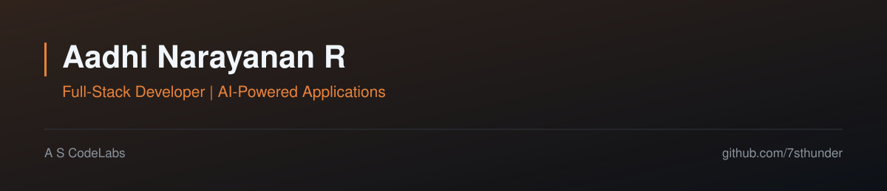

       

## About

I build full-stack systems at **A S CodeLabs**, where most of the work is business-critical software rather than demos: logistics operations, print production, recruitment pipelines and medication adherence tooling. Alongside that I ship independent projects in document forensics and applied AI.

The through-line is **software you can defend** — measurable signals, auditable decisions, and deployments that survive contact with real data.

| Focus | What it means in practice |
| --- | --- |
| Frontend engineering | Typed React and Next.js applications with shared design tokens, route-level data loading through tRPC and React Query, and accessibility regressions caught by axe in CI rather than by eye. |
| Backend systems | tRPC and FastAPI services where domain logic lives in pure, unit-tested modules instead of request handlers, and each capability is isolated so a single failure degrades one signal instead of the whole pipeline. |
| Database design | Schema changes shipped as reviewed Drizzle migrations, relational modelling in Postgres, and D1 where the deployment target is the edge. |
| AI integration | Models used where they genuinely help and bounded where they must not: Gemini for adherence insight and speech intake, and an LLM pass in the forensics engine capped at 10% of the score and off by default. |
| Application architecture | Monorepos with separate app and shared package layers, background workers and scheduled jobs, and CI gates on typecheck, lint, tests and the production build. |

## Featured Work

| Project | What it is | Built&nbsp;with |
| --- | --- | --- |
| **[DocuVerify](https://github.com/7sthunder/DocuVerify)** Document authenticity and forgery detection built as an evidence platform rather than a binary classifier. A PDF or image is run through a multi-signal forensic engine and returned with a 0–100 suspicion score, a LOW / MEDIUM / HIGH verdict, and highlight boxes drawn on the rendered page — every finding cites the measurement behind it. |          |
| **[MediTrack AI](https://github.com/7sthunder/medvault)** Medication adherence platform answering two questions: what to take now, and how well the schedule is being followed. A Next.js App Router front end over a tRPC domain layer and a 17-table Postgres schema, with dose and adherence engines written as pure functions and a caregiver loop for escalations and shared visibility. |          |
| **[Aegis AI](https://github.com/a-s-codelabs/aegis-ai)** AI-assisted scam-call detection across a web front end, a REST backend shaped for mobile consumption, and a native Android overlay module, so a call is analysed while it is happening rather than after the fact. |       |
| **[FairloanAI](https://github.com/a-s-codelabs/FairloanAI)** AI loan negotiation workspace that turns long-form loan agreements into structured, comparable data and simulates lender-versus-borrower negotiation, aligned to LMA Green Loan Principles. Both sides are scored for risk and satisfaction, then concessions and a suggested position are generated as structured output. |       |
| **[Portfolio](https://github.com/7sthunder/portfolio)** The site behind this profile — a React and Vite build whose content lives in a single data file, so projects and stack update without touching components. Deployed to GitHub Pages on every push to the default branch. |       |

## Team Work

Production work built with other people at **A S CodeLabs** and with collaborators on shared repositories. Source for the client products is private, so those rows link to the live product; commit counts are from the repository history.

| Project | My contribution | Built&nbsp;with |
| --- | --- | --- |
| **Transport Management System** [tms.ascodelabs.com](https://tms.ascodelabs.com) | 396 commits — the largest single contribution on the codebase. Shipped the shipment lifecycle (written on save, correct per-day numbering), freezing a trip once it is closed and invoiced, invoice adjustments and the expense model, alongside the fleet, driver and revenue views. |          |
| **A S Unique Group** [asuniquegroup.com/app](https://asuniquegroup.com/app) | 238 commits on the overseas-hiring platform. Built the Candidate Pool — manual lead entry with rich fields and file uploads, lead-source and age-based temperature bands — moved submission detail into a side panel, fixed the invitation constraint that blocked accepting into multiple workspaces, and published requirements to the public job portal. |          |
| **CrossFit OS** [crossfitos.com](https://crossfitos.com) | 170 commits on a multi-tenant gym platform. Built gym-owner onboarding with human review and a subscription gate, the staff-only review console, the owner account menu on the landing page, and fixed the social feed on phones (no sideways scroll, readable bottom navigation, no colliding thread panel). |          |
| **STAMP** [stamp-crm.ascodelabs.com](http://stamp-crm.ascodelabs.com/) | 21 commits on a print-shop production manager. Cut the UI over to the real tRPC client and deleted the mock layer, added the tRPC service and file-upload path, wired SSE notifications with shared domain rules and CI, and configured the Cloudflare Workers deployment with R2. |          |
| **[HAWKINS: NITRO RUN](https://github.com/sruthideepa82-cpu/Hawkinrace)** Browser racing game | 10 commits on the gameplay layer — a chase camera with a rotatable minimap, wall-collision response, race state transitions, per-page routing so a race no longer restarts at the chequered flag, and the track set that made the extra courses raceable. |       |

## Contact

| Channel | Link |
| --- | --- |
| GitHub | [github.com/7sthunder](https://github.com/7sthunder) |
| Portfolio | [7sthunder.github.io/portfolio](https://7sthunder.github.io/portfolio/) |
| LinkedIn | [linkedin.com/in/aadhi-narayanan-80093332](https://linkedin.com/in/aadhi-narayanan-80093332) |
| Email | [aadhinarayanan23r@gmail.com](mailto:aadhinarayanan23r@gmail.com) |

## GitHub Activity

  
  

  

